<p align="center">
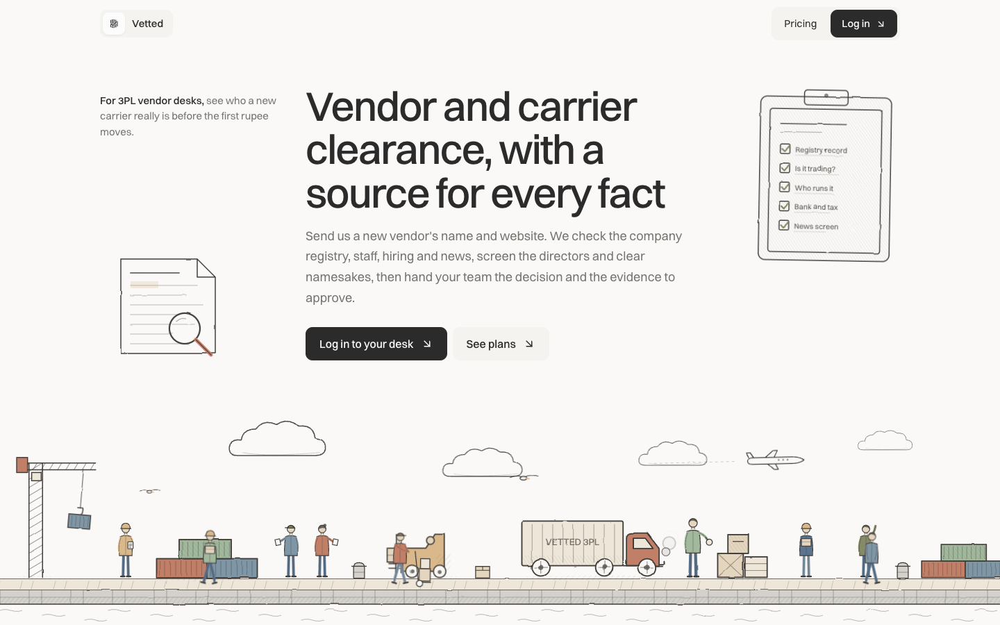
</p>

<div align="center">

# Vetted
### Vendor and carrier clearance, with a source for every fact.

An agent service that does a 3PL's whole vendor-clearance job: it proves a new vendor is registered, trading and run by
its directors, screens those directors against the news, clears namesakes, checks tax and bank details, and hands a person
a decision in which every fact links to the record it came from. Irreversible actions wait for a named approver and run
exactly once, even if the service is killed and restarted.

[](https://python.org)
[](https://fastapi.tiangolo.com)
[](https://react.dev)
[](https://sqlite.org)
[](https://docs.crustdata.com)
[](https://console.groq.com)
[](tests/cases.json)
[](https://contextcon-bitspilani.com)

**Live:** [ui-delta-sand.vercel.app](https://ui-delta-sand.vercel.app) (website, Vercel) · API [vetted-crustdata.onrender.com](https://vetted-crustdata.onrender.com/api/summary) (Render)
· Demo login `demo@vetted.example` / `vetted-demo`

</div>

---

## Table of contents

1. [Overview](#overview)
2. [The job, who pays for it, and the pass mark](#the-job-who-pays-for-it-and-the-pass-mark)
3. [Product tour](#product-tour)
4. [Key features](#key-features)
5. [Technical architecture](#technical-architecture)
6. [Pipeline deep dive](#pipeline-deep-dive)
7. [Evidence model and the source check](#evidence-model-and-the-source-check)
8. [Decision rules](#decision-rules)
9. [Exactly-once actions and restart safety](#exactly-once-actions-and-restart-safety)
10. [Data model](#data-model)
11. [API reference](#api-reference)
12. [Data sources](#data-sources)
13. [Security, privacy and approvals](#security-privacy-and-approvals)
14. [Business architecture](#business-architecture)
15. [Plans, payments and unit economics](#plans-payments-and-unit-economics)
16. [Tests and results](#tests-and-results)
17. [Run it locally](#run-it-locally)
18. [Hosting](#hosting)
19. [Repository layout](#repository-layout)
20. [Roadmap](#roadmap)
21. [Prepared before the build, and credits](#prepared-before-the-build-and-credits)

---

## Overview

| | |
|---|---|
| **Track** | ContextCon 05 · Trust and compliance (5.1 The Vendor Check, 5.2 The Adverse Media Screen) |
| **Client** | A mid-size Indian third-party logistics company (3PL) onboarding carriers, fleet owners and warehouse vendors every week |
| **Input** | A vendor's name and website, optionally CIN, GSTIN, PAN, Udyam, PIN code, bank details, contact and the directors it claims; or free text naming one or several vendors |
| **Output** | `CLEARED`, `DUPLICATE_HELD`, `REJECTED`, `REFER` or `CANNOT_VERIFY`, the four answers the client asked for (real and trading? who runs it? how long has it existed? anything off?), every fact with its source, passage and dates, a claimed-vs-record table, the personal data used, and proposed actions for a person to approve |
| **Stack** | Python 3.11 · FastAPI · SQLite (WAL) · httpx · BeautifulSoup · RapidFuzz · React 18 · Vite 5 · Tailwind 3 · Lenis |
| **LLM** | Groq `openai/gpt-oss-120b` (fallback `gpt-oss-20b`), used only to split and read free-text requests. Never a source of facts; the service works without it |

---

## The job, who pays for it, and the pass mark

Before a vendor goes into a 3PL's vendor master and is paid, someone must establish that it is a real, active business,
that it is not a duplicate or a lookalike, and that the people running it are clean. Today the 3PL's **procurement and
compliance team** does this by hand, often with **outside verification firms paid per business checked**. It takes days per
vendor and holds up dispatch. Vetted does the whole job: *a vendor cleared, with the evidence on file*, or a clear "no", or
"cannot verify" with exactly what is missing.

**Pass mark**

- **0 wrong clearances.** A vendor is never `CLEARED` without an Active registry record tied to it by a second identifier
  (the supplied CIN, the website on the record, the exact legal name, or the city).
- **Hard cases correct or `CANNOT_VERIFY`:** duplicates, lookalike names and websites, common names with nothing to tell them apart.
- **Every fact sourced** with passage and date; a fact whose value is not in its own passage is dropped.
- **Each irreversible action executed exactly once** after a kill and restart.
- **Within limits:** at most 240 s of active time, 40 credits and ₹400 per vendor (`policy.yaml`).

Current result: **13 / 13 test cases passed, 0 wrong answers**; kill test passed.

---

## Product tour

| New check | Result: summary |
|---|---|
| 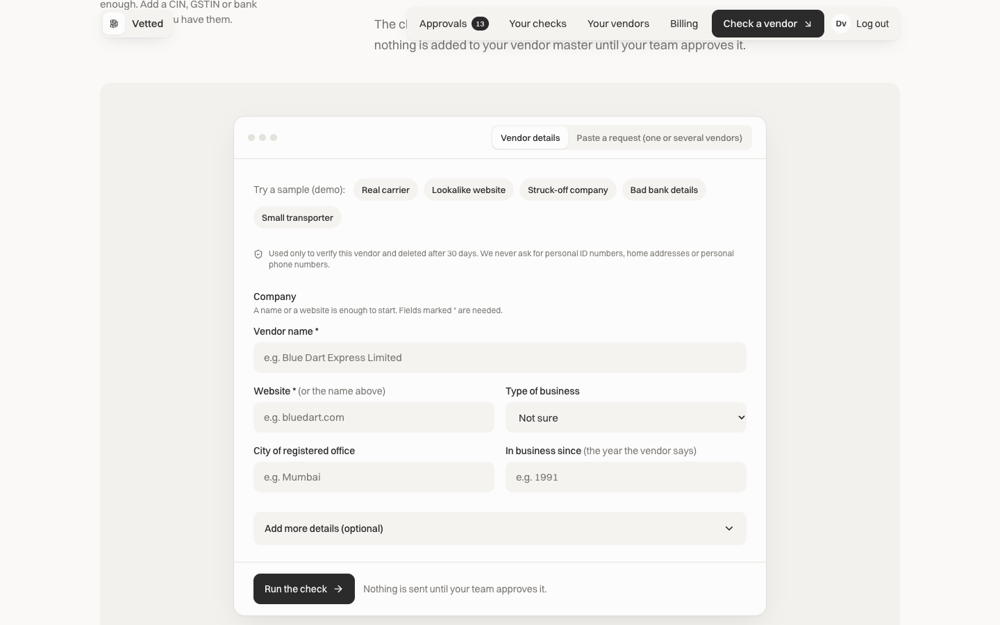 | 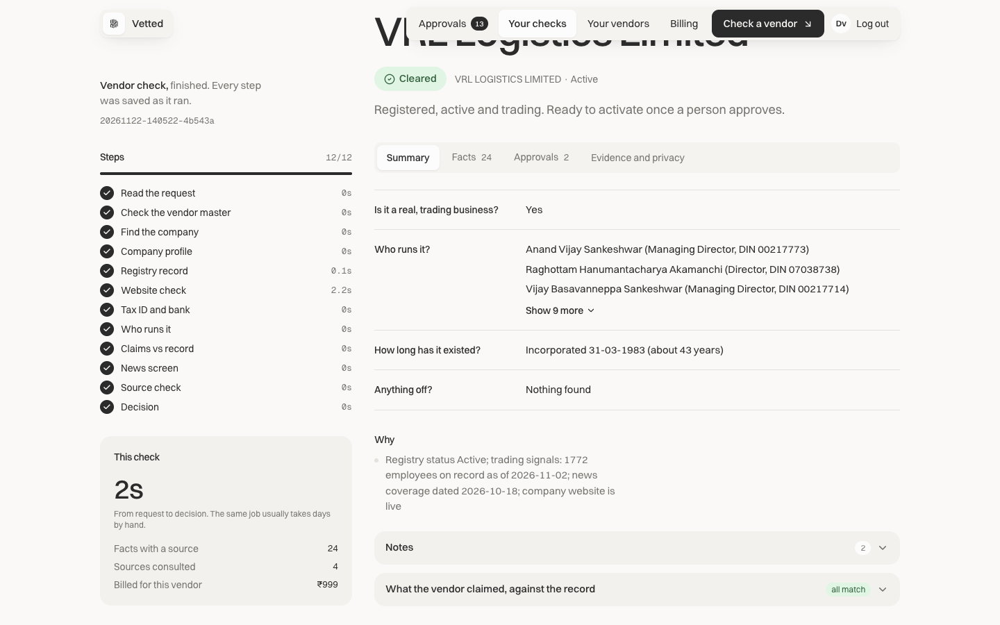 |
| **Facts, each with its source (click for the passage)** | **A lookalike caught** |
| 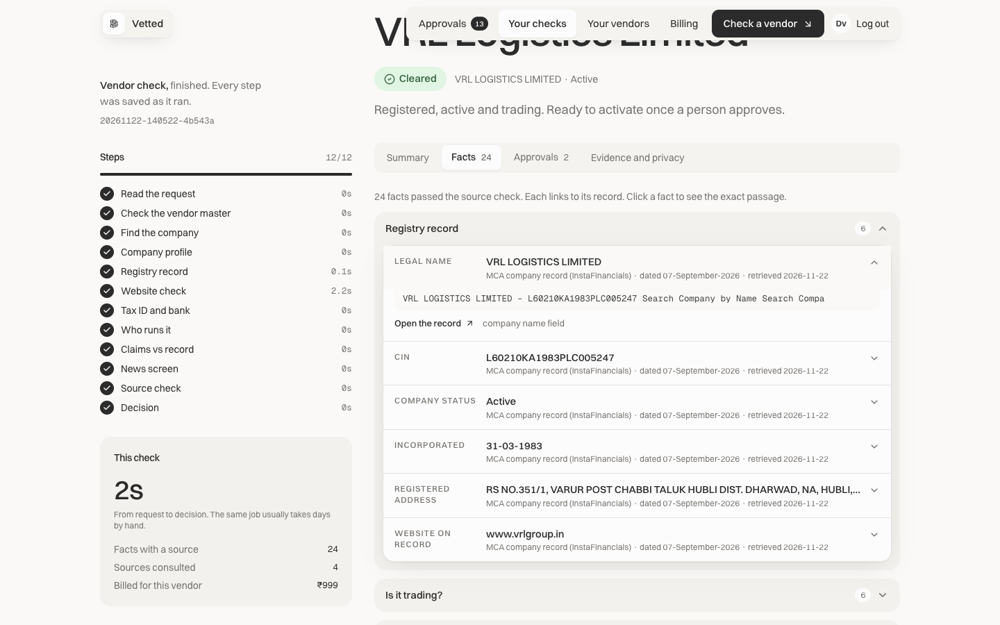 | 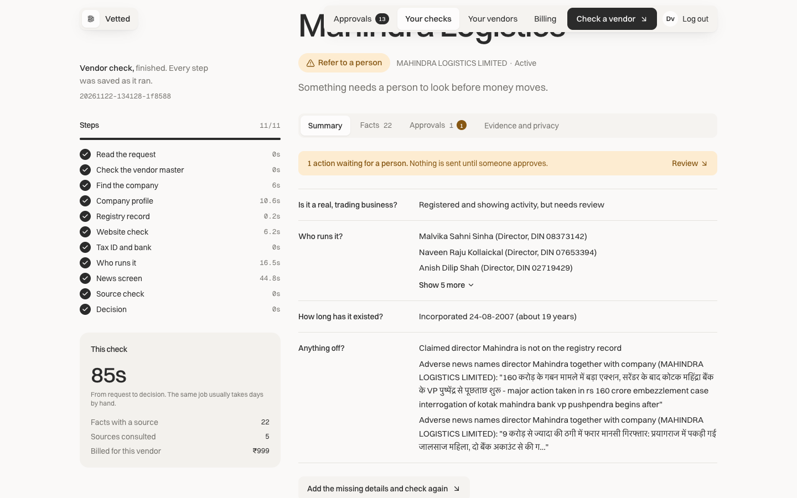 |
| **Approvals: named approver, stamp, exactly once** | **Plans and test-mode checkout** |
| 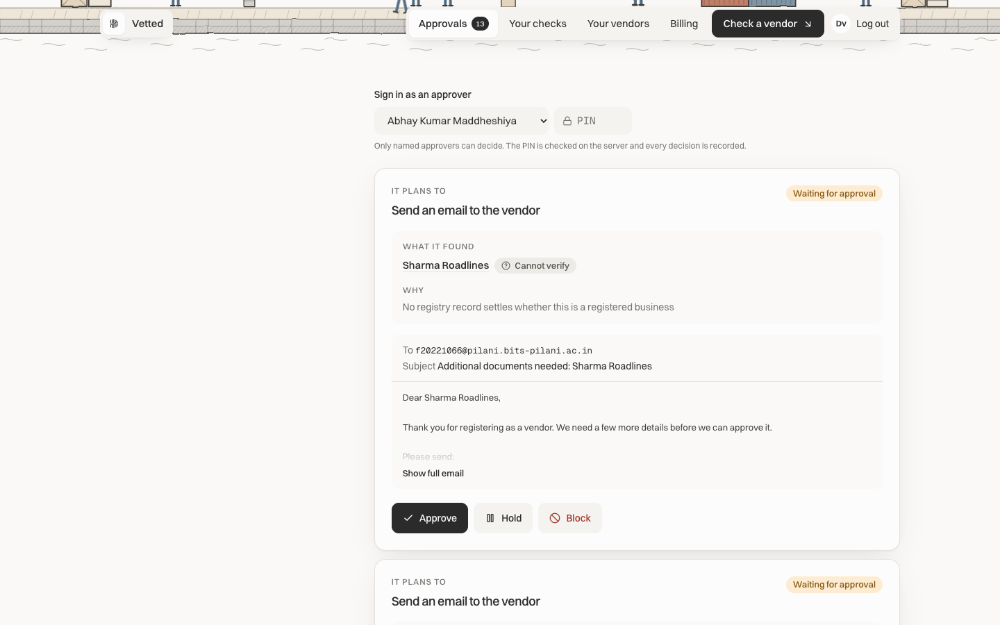 | 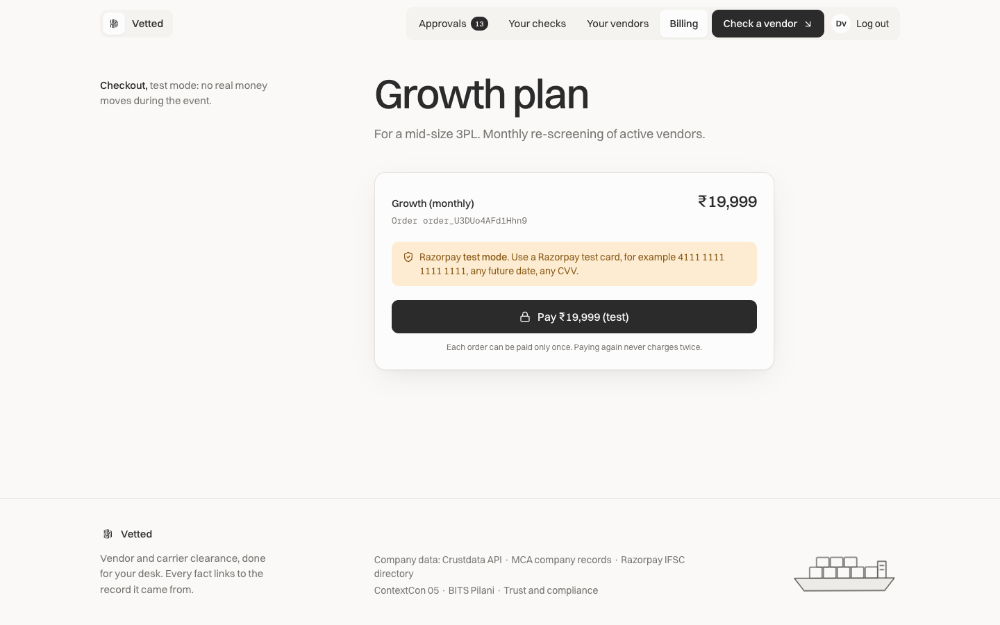 |

---

## Key features

| # | Feature | Detail |
|---|---|---|
| 1 | **Whole-job pipeline** | 12 checkpointed steps from request to decision; one vendor or a batch from one free-text request |
| 2 | **Registry first** | MCA company record (legal name, CIN, status, incorporation, address, directors with DIN) via public mirror pages, confirmed by a second identifier |
| 3 | **Is it trading?** | Crustdata dated headcount, open jobs, news; live website check |
| 4 | **Run by its director** | Crustdata Person Search + Person Enrich confirm a director's current role and start date at the company |
| 5 | **Adverse media + namesakes** | News per director; an article counts only if it also names the company, the DIN or the city, otherwise it is recorded as a cleared namesake |
| 6 | **Lookalikes and typo domains** | Brand-name similarity and near-copy domains (`vrl-group.in` vs `vrlgroup.in`) |
| 7 | **Tax and bank checks** | GSTIN check digit, state and embedded PAN; live IFSC lookup; account holder vs legal name; shared-account detection |
| 8 | **Claimed vs record** | Contact email domain, contact person at the company, "in business since", PIN code, PAN, Udyam format |
| 9 | **Source check** | Plain code drops any fact whose value does not appear in its own quoted passage |
| 10 | **Exactly-once actions** | Outbox with idempotency keys, atomic claim, reconcile after a crash |
| 11 | **Approvals** | Named approvers with PINs; block needs a reason; full audit trail |
| 12 | **Evidence file** | Markdown download or printable PDF for the client and its auditors |
| 13 | **Privacy by design** | Only directors' names and DINs from public records; bank numbers stored only as a hash and last 4 digits; 30-day purge |
| 14 | **Team-only email** | Real SMTP, but only to allow-listed domains; anything else is saved as a file and never sent |
| 15 | **Login** | Salted PBKDF2 hashes, server-side sessions in an HttpOnly cookie; every API route behind a session |
| 16 | **Plans and checkout** | Three plans, invoice preview, Razorpay test-mode checkout with server-side signature verification, paid exactly once |
| 17 | **Cost ledger** | Every call recorded with credits, tokens and rupees, full cost and paid-after-cache |

---

## Technical architecture

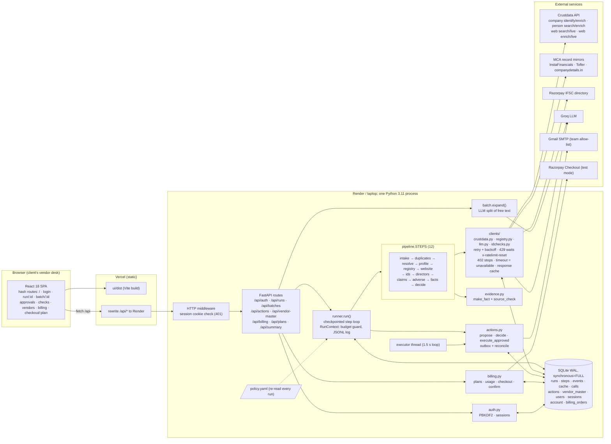

**Request lifecycle.** `POST /api/runs` → request protected (bank number hashed) → `batch.expand` (one or many requests) → a
run row per vendor → background thread `runner.run()`. Each step's output is written to `steps` before the next starts;
every external call goes through a client that checks the cache (24 h TTL), the budget, and writes the cost ledger. After
`decide`, `actions.propose_actions` writes idempotent outbox rows; the executor thread runs them once approved.

### Pipeline sequence

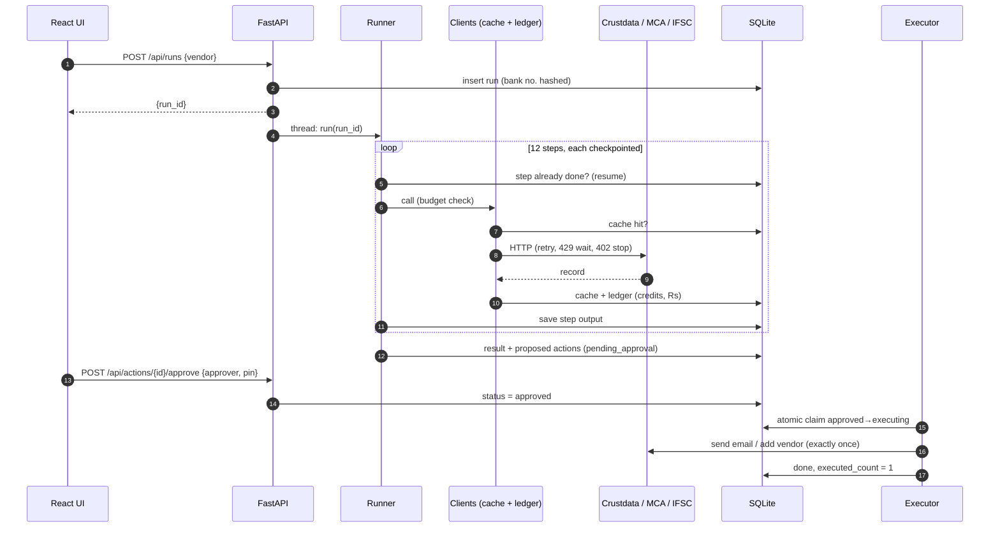

---

## Pipeline deep dive

| # | Step | What it does | Sources | Typical cost |
|---|---|---|---|---|
| 1 | `intake` | Normalises fields; free text read by the LLM (pattern fallback) | Groq (optional) | 0 |
| 2 | `duplicates` | Exact GSTIN/PAN/CIN/domain, strict name match, shared bank hash against the vendor master; exact duplicates skip all paid steps | SQLite | 0 |
| 3 | `resolve` | Company Identify by domain, name and brand; ambiguity and lookalike/typo-domain detection | Crustdata `/company/identify` | 0.2–0.6 cr |
| 4 | `profile` | Basic info, dated headcount, hiring, news, founders and CXOs (`people.founders`, `people.cxos` only: 1.7 s instead of 83 s) | Crustdata `/company/enrich` | 2 cr |
| 5 | `registry` | CIN from legal-name pages or web-search snippets; record verified by name similarity and a second tie | companydetails.in, Crustdata `/web/search/live`, InstaFinancials, Tofler | 0–3 cr |
| 6 | `website` | Direct fetch first (free), Crustdata fetch only if blocked; blocked ≠ dead | direct, Crustdata `/web/enrich/live` | 0–1 cr |
| 7 | `ids` | GSTIN check digit, state, embedded PAN, PAN holder type; IFSC lookup | code, Razorpay IFSC | 0 |
| 8 | `directors` | Registry directors matched to Crustdata people; Person Search + Enrich for top directors | Crustdata `/person/search`, `/person/enrich` | 0.3–1.7 cr |
| 9 | `claims` | Contact email domain, contact person at company, in-business-since, PIN, holder, PAN, Udyam | code + Crustdata | 0–0.3 cr |
| 10 | `adverse` | News per director with the two-identifier namesake rule | Crustdata `/web/search/live` (news) | 0–3 cr |
| 11 | `facts` | Builds cited facts; runs the source check | code | 0 |
| 12 | `decide` | Policy rules → decision, four answers, documents to request, personal-data record | `policy.yaml` | 0 |

Measured: about **₹25–39 per fresh check** (≈3–4.6 credits at the assumed ₹8.5 per credit), **54–95 s**.

---

## Evidence model and the source check

```python
fact = {"subject", "field", "value", "source", "url", "locator",   # e.g. "company status field"
        "passage", "record_date", "retrieved_at", "note", "verified"}
verified = normalise(value) in normalise(passage)                     # plain code, no model
```

A fact that fails the check is moved to `rejected_facts` and cannot support a decision, so a value can never come from a
model's memory. Timeouts and blocks are reported as *the source did not respond*, never as *no record*.

## Decision rules

Evaluated in order (`vetted/pipeline.py::step_decide`, thresholds in `policy.yaml`):

1. Exact or strict-name duplicate → `DUPLICATE_HELD`
2. Registry status in `reject_statuses` (Strike Off, Dissolved, Under Liquidation, ...) → `REJECTED`
3. Any other non-Active status → `REFER`
4. Lookalike, shared bank account, tax/bank flag, claim mismatch or confirmed adverse media → `REFER`
5. No registry record tied by a second identifier → `CANNOT_VERIFY` (names what is missing; a proprietorship is asked for GST)
6. Active, at least one trading signal in 180 days, no flags → `CLEARED`; flags present → `REFER`
7. Active but no trading signal → `REFER` (possible front); a company younger than 6 months is always flagged

---

## Exactly-once actions and restart safety

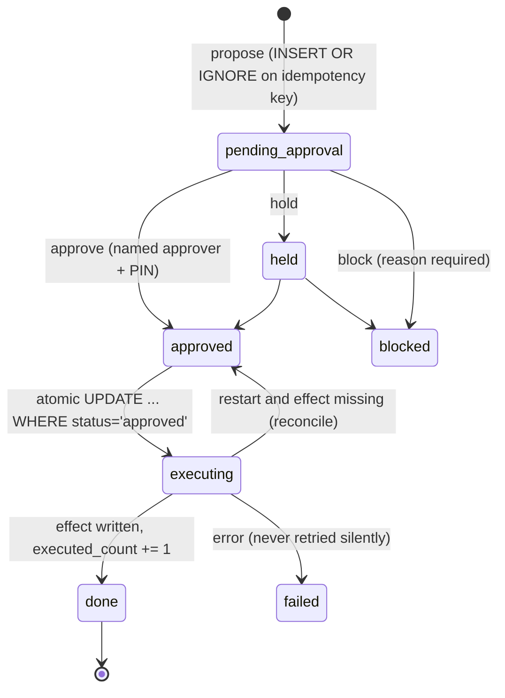

- **Checkpoints:** every step output is stored before the next step; on start-up the API resumes every `running` run from
  its first unfinished step. The time limit counts active time only, so downtime after a kill is not charged.
- **Cache:** responses are keyed by request hash, so a resumed run never pays twice (`paid calls repeated after restart: 0`).
- **Effects are provable:** the vendor row (keyed by action id) and the `.eml` file (written atomically, last) prove an action
  happened; on restart, reconcile marks it done if the effect exists and re-runs it only if the effect is missing.
- **Payments:** each checkout order is paid once; a repeated confirmation returns `already_paid`.

## Data model

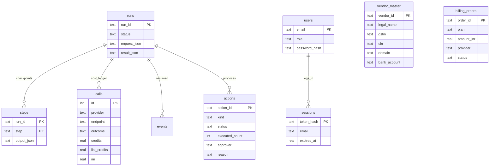

## API reference

| Method | Path | Auth | Purpose |
|---|---|---|---|
| POST | `/api/auth/login` · `/api/auth/logout` · GET `/api/auth/me` | public | Session cookie |
| POST | `/api/runs` | session | Start a check (one vendor, `vendors[]`, or `text`); returns `run_id` or `batch_id` |
| GET | `/api/runs` · `/api/runs/{id}` · `/api/batches/{id}` | session | Status, steps, result, actions, events |
| GET | `/api/runs/{id}/evidence[?fmt=html]` | session | Evidence file (Markdown or printable HTML) |
| GET | `/api/runs/{id}/ledger` · `/api/runs/{id}/log` | session | Cost ledger and JSONL log (screening) |
| GET / POST | `/api/actions` · `/api/actions/{id}/{approve,hold,block}` | session + PIN | Approval queue |
| GET / POST | `/api/vendor-master` · `/api/vendor-master/import` | session | Client records |
| GET | `/api/plans` · `/api/summary` | public | Plans; health and counts |
| GET / POST | `/api/billing` · `/api/billing/checkout` · `/api/billing/confirm` | session | Usage, test-mode checkout, verify |

## Data sources

| Source | Used for |
|---|---|
| Crustdata `POST /company/identify` | Resolve name, domain and brand to a company; lookalike candidates |
| Crustdata `POST /company/enrich` | Dated headcount, hiring, news, founders and CXOs with current roles |
| Crustdata `POST /person/search` + `/person/enrich` | A director's or contact's current role at the company |
| Crustdata `POST /web/search/live` | CIN discovery; adverse-media news search per director |
| Crustdata `POST /web/enrich/live` | Website check when direct fetch is blocked |
| MCA records via InstaFinancials, Tofler, companydetails.in | Legal name, CIN, status, incorporation, address, directors with DIN, record date |
| Razorpay IFSC directory | Bank and branch for an IFSC |
| Groq `openai/gpt-oss-120b` | Reading and splitting free-text requests only |

---

## Security, privacy and approvals

- **Personal data:** only directors' names and DINs from public company records, plus current roles; no personal emails,
  phones or home addresses. Every report lists exactly what was used and why; `python -m vetted purge` deletes runs older
  than `privacy.retention_days` (30).
- **No guilt by name:** adverse news needs a second identifier; cleared namesakes are recorded with the reason.
- **Fair to small businesses:** low web presence leads to `CANNOT_VERIFY` and a document request, never a rejection.
- **Vendor emails** ask only for documents the vendor can provide; internal findings stay with the reviewer.
- **Approvals:** named approvers with PINs checked on the server; blocking needs a reason; full audit trail.
- **Email safety:** sent only to `email.allow_domains`; otherwise saved as a file and never sent.
- **Secrets** live in `.env` (git-ignored) or the host's environment; settings are read with stray quotes stripped.
- **Bank numbers** are stored only as a salted SHA-256 hash and the last 4 digits.
- **Login:** salted PBKDF2-SHA256 (200,000 iterations), session token stored only as a hash, HttpOnly, SameSite=Lax, Secure behind HTTPS.
- **Public demo protection:** `MAX_RUNS_PER_HOUR` caps checks on the hosted site.

---

## Business architecture

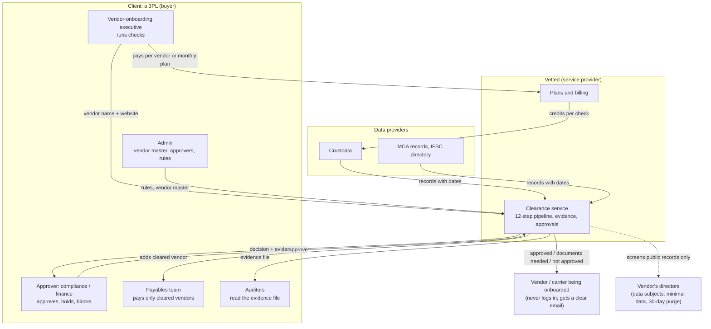

**Customers, in order:** mid-size 3PLs → truck and freight aggregators → e-commerce and quick-commerce seller onboarding →
manufacturers and FMCG supplier onboarding → later banks and fintechs (business checks before lending).
**Go to market:** pay-as-you-go with no procurement hurdle, convert to Growth above ~20 vendors a month, partner later with
TMS/ERP vendors through an API.

## Plans, payments and unit economics

| Plan | Price | Includes |
|---|---|---|
| Pay as you go | ₹999 per vendor | Full check, evidence file, approvals |
| Growth | ₹19,999 / month | 30 checks, ₹599 per extra, monthly re-screening of 200 vendors |
| Scale | ₹59,999 / month | 120 checks, ₹499 per extra, 1,000 monitored vendors, ERP API |

Checkout runs **in test mode only**: with `RAZORPAY_KEY_ID` (`rzp_test_...`) and `RAZORPAY_KEY_SECRET` it creates a Razorpay
order and verifies the payment signature (`HMAC-SHA256(order_id|payment_id)`) on the server; without keys it runs a clearly
labelled simulated test payment. Live keys are refused.

**Unit economics (measured from the cost ledger):** ≈₹25–39 per fresh check against ₹499–999 charged, a gross margin above
90%. Exact duplicates cost ₹0. These provider numbers are deliberately not shown in the client's app.

---

## Tests and results

| Test | Command | Result |
|---|---|---|
| Evaluation set (13 cases incl. duplicates, lookalike name, typo domain, common name, struck-off, bad GSTIN, fake IFSC, shared bank) | `python -m tests.evaluate` | **13 / 13 passed, 0 wrong answers** (runs on an isolated copy of the database) |
| Kill and restart | `python -m tests.kill_test "Vendor" domain.com` | kill -9 mid-run, restart, **0 paid calls repeated**, every action `executed_count = 1` |
| Smoke | `python -m tests.smoke` | Four vendors end to end |

## Run it locally

```bash
python3 -m venv .venv && .venv/bin/pip install -r requirements.txt
cp .env.example .env            # CRUSTDATA_API_KEY, optional GROQ_API_KEY, SMTP_*, APPROVERS, APP_USERS, RAZORPAY_*
.venv/bin/uvicorn vetted.api:app --port 8000          # http://localhost:8000 (serves ui/dist)

# command line
.venv/bin/python -m vetted run --name "Blue Dart Express Limited" --website bluedart.com --md
.venv/bin/python -m vetted run --text "Please clear TCI Express Limited, tciexpress.in"
.venv/bin/python -m vetted run --file batch.json        # {"vendors": [...]}
.venv/bin/python -m vetted resume <run_id>
.venv/bin/python -m vetted actions --status pending_approval
.venv/bin/python -m vetted decide <action_id> approve --approver "Name" --pin 1234
.venv/bin/python -m vetted import-master clients_vendor_master.csv
.venv/bin/python -m vetted purge                         # retention
.venv/bin/python -m vetted reset                         # clear demo runs (keeps cache)
```

UI development: `cd ui && npm install && npm run dev` (proxies `/api` to port 8000); `npm run build` refreshes `ui/dist`.

**Requirement changes and live fixes:** thresholds, limits, plans, decision rules, output fields and an outage switch
(`simulate.unavailable: ["registry"]`) live in [`policy.yaml`](policy.yaml), re-read on every run. A new check is one
function plus one line in `STEPS`.

## Hosting

- **Backend on Render** ([`render.yaml`](render.yaml)): `pip install -r requirements.txt` then
  `uvicorn vetted.api:app --host 0.0.0.0 --port $PORT`; secrets in the Render dashboard. The free plan has no lasting disk,
  so the service re-seeds the fixture vendor master and demo account on start.
- **Website on Vercel** (root `ui`): [`ui/vercel.json`](ui/vercel.json) rewrites `/api/*` to the Render service.
- **Live kill-and-restart demo:** run locally.

## Repository layout

```
vetted/
  api.py            FastAPI app, auth middleware, routes, startup resume and seeding
  runner.py         checkpointed step loop, budget guard, resume events
  pipeline.py       the 12 steps and the decision rules
  evidence.py       facts and the source check
  actions.py        approval queue and exactly-once executor
  billing.py        plans, usage, Razorpay test checkout, exactly-once payment
  auth.py           PBKDF2 passwords and sessions
  batch.py          free-text and multi-vendor requests
  idchecks.py       GSTIN, PAN, IFSC
  privacy.py        bank number hashing
  clients/          crustdata.py · registry.py · llm.py
  evidence_file.py  Markdown / printable evidence file
  store.py          SQLite schema and access
ui/                 React app (ui/dist is the built copy served by the API)
tests/              cases.json · evaluate.py · kill_test.py · smoke.py · fixtures/
docs/               architecture.md · images/
policy.yaml         every rule, threshold, limit and plan
```

## Roadmap

Designed but not built during the event: many 3PLs on one service (a `companies` table scoping every run, action, vendor
and setting), self-serve sign-up and roles (admin, approver, analyst), per-client email identity, usage metered and invoiced
per company, API keys for ERP integration, an operator console for Vetted staff, Postgres for hosting with a lasting
database, and monthly re-screening through Crustdata Watchers.

## Prepared before the build, and credits

Before building began at 10:15 AM we prepared only the idea, notes on the event rules and the Crustdata docs, and a written
plan. No code was written before the build.

Open-source software: FastAPI (MIT), Uvicorn (BSD-3), httpx (BSD-3), Pydantic (MIT), PyYAML (MIT), python-dotenv (BSD-3),
Beautiful Soup (MIT), RapidFuzz (MIT), python-multipart (Apache-2.0), React (MIT), Vite (MIT), Tailwind CSS (MIT), PostCSS
(MIT), Autoprefixer (MIT), lucide-react (ISC), Lenis (MIT), Switzer font by Indian Type Foundry via Fontshare (ITF Free Font
License), Geist Mono (SIL OFL 1.1).
