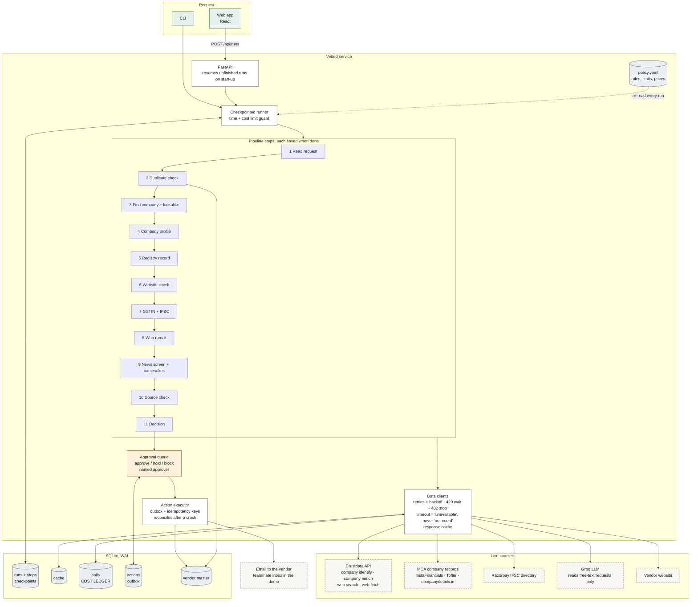

# Vetted: architecture

## Where things sit

| Concern | Where |
|---|---|
| Data calls | `vetted/clients/crustdata.py`, `vetted/clients/registry.py`, `vetted/idchecks.py`, `vetted/clients/llm.py` |
| Retries | every client: backoff on timeouts and 5xx, wait on 429 using `x-ratelimit-reset`, stop on 402 |
| Cost ledger | `calls` table: provider, endpoint, outcome, credits (`X-Credits-Used`), tokens, ₹, duration; shown live in the UI |
| Limits | `RunContext.check_budget()` before every paid call (`policy.yaml` → `limits`) |
| Approvals | `actions` table, `vetted/actions.py`; UI *Approvals* page; every verdict records the approver |
| Exactly once | idempotency key per action, atomic claim (`approved → executing`), reconcile on restart |
| Resume after a kill | `steps` table checkpoints + response cache; API resumes `running` runs on start-up |
| Evidence | `vetted/evidence.py`: fact = value + source + URL + passage/field + record date + retrieval date; source check |
